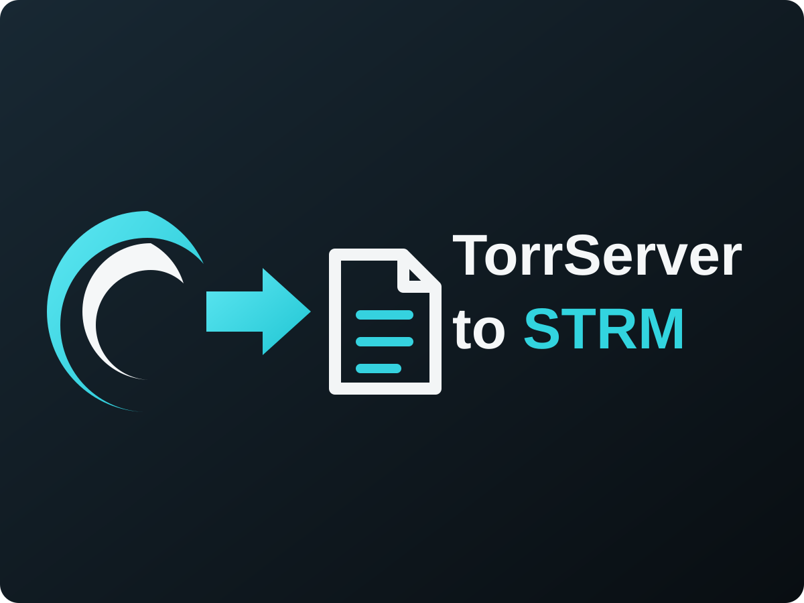

# Jellyfin.Plugin.TorrServer

## Сборка
Нужен .NET SDK 8 и доступ к NuGet.

    dotnet publish -c Release -o out

Скопируйте `out/Jellyfin.Plugin.TorrServer.dll` в папку плагинов Jellyfin:

    <config>/plugins/TorrServer_1.0.0.0/Jellyfin.Plugin.TorrServer.dll

(Docker: /config/plugins/TorrServer_1.0.0.0/). Перезапустите Jellyfin.

## Настройка
1. Панель управления → Плагины → TorrServer → адрес вида `http://192.168.1.50:8090`
   (адрес должен открываться с машины, где работает Jellyfin; в Docker не используйте 127.0.0.1).
2. «Проверить подключение», затем «Синхронизировать сейчас».
3. Добавьте библиотеки: «Фильмы» → `<data>/torrserver/Movies`, «Сериалы» → `<data>/torrserver/Shows`
   (путь покажет/задаст поле «Папка для .strm файлов»).
4. В библиотеках отключите «Извлекать картинки глав» и генерацию Trickplay — иначе Jellyfin будет
   качать торренты целиком ради превью.

## Использование
В левом меню появится пункт TorrServer: сетка постеров, поле добавления magnet/.torrent,
«Воспроизвести» (поток через Jellyfin → TorrServer прямо в браузере) и «В библиотеке»
(карточка в Jellyfin с метаданными, транскодингом и воспроизведением на любых клиентах).

> CI builds `Jellyfin.Plugin.TorrServer.dll` with GitHub Actions.

## Установка и обновления через репозиторий Jellyfin

Добавьте пользовательский репозиторий в Jellyfin:

`Панель управления -> Плагины -> Управление репозиториями -> +`

**Название:** `TorrServer to STRM`

**URL:**

`https://raw.githubusercontent.com/Steinus/torrserver-strm-for-jellyfin/main/manifest.json`

После этого плагин можно устанавливать и обновлять через каталог Jellyfin. Релизы, ZIP-пакет, контрольная сумма и manifest.json публикуются автоматически GitHub Actions.

